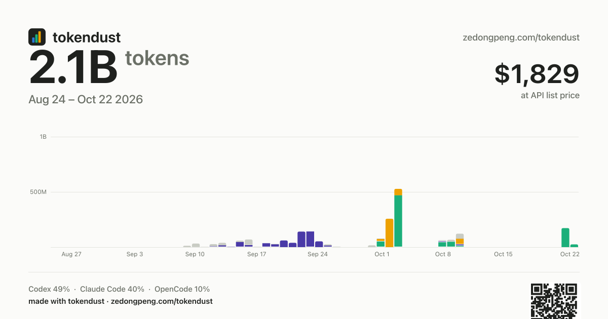

<div align="center">



# tokendust

**What your AI actually costs.**

Run one command on every machine you code on, drop the files on one page, get a picture worth posting.

</div>

Your subscriptions hide the quantity. A flat fee makes a heavy day and a quiet day look identical.
tokendust counts the tokens the agents on your machines actually sent and received, prices them at
API list rates, sums every machine, and draws one card that carries the receipt.

```
$ python3 scan.py
tokendust-macbook.json: 253 rows, 4.5B tokens from claude-code, codex, cursor, opencode
Next: open index.html and drop the file on it.
```

---

## Quick start

1. **Scan each machine.** Save `scan.py` anywhere and run it. macOS, Linux and Windows; Python 3.8+
   and nothing else. No `pip install`, no Node, no account.

   ```bash
   python3 scan.py                    # every agent found on this machine, last 400 days
   python3 scan.py --days 90          # shorter window
   python3 scan.py --cursor           # also read Cursor's dashboard (one network call)
   ```

   It writes `tokendust-<hostname>.json` next to itself. That file holds daily totals per tool and
   model — no prompts, no paths, no project names, no session ids.

2. **Drop the files on the board.** Open [`index.html`](index.html) (double-click works, no server)
   and drop one file per machine. The board sums them and prices the tokens.

   Or skip step 1 on a machine without Python: the same board is live at
   **[zedongpeng.com/tokendust](https://zedongpeng.com/tokendust)**.

3. **Take the card.** Two formats, 1200×630 for X/LinkedIn and 1080×1350 for stories. Download PNG
   or copy the image straight to the clipboard.

Nothing is uploaded. The page is one file and runs entirely in the tab.

## What it counts

| Tool | Read from | Notes |
| --- | --- | --- |
| Claude Code | `~/.claude/projects/**/*.jsonl` | deduped by message id + request id, subagent replays dropped — the ccusage rules |
| Codex | `~/.codex/sessions/**/*.jsonl` | cumulative snapshots deduped; a sub-agent's replay of its parent is not counted again |
| OpenCode | `opencode.db` under `$XDG_DATA_HOME` | reasoning tokens billed as output |
| Gemini CLI | `~/.gemini/tmp/**/chats/*.json` | per-message usage; the file's own totals are ignored |
| Cursor | Cursor's dashboard, `--cursor` | server-side only, ~3.5 months, per account: point one machine at it, not all |

**What it cannot count:** anything that only exists in a browser (the ChatGPT, Claude and Gemini web
apps). Those have no local log. A tool that keeps its numbers on a server has no local record either.
So the total is honest about what it saw, not a census of every token you have ever spent.

## Accounting rules

- **One request, one count.** Claude Code writes a line per content block and copies responses into
  several transcripts; rows are deduplicated the way ccusage does it. Codex reports cumulative
  totals, so repeated snapshots are dropped.
- **Cache is separate.** Uncached input, cache reads and cache writes are three columns with three
  prices, an order of magnitude apart.
- **List price, not your bill.** Every dollar figure is what those tokens would cost at official API
  rates, from [`prices.json`](prices.json). If you are on a subscription the real bill is smaller.
  That gap is the interesting part. Unpriced models are ranked but excluded from the dollar figure
  and flagged on the board.
- **History outlives logs.** Claude Code drops session logs after about 30 days. `scan.py` keeps its
  own per-machine history under `~/.local/state/tokendust/`, so a rescan never shrinks a day.

## Multi-machine

Each machine produces its own file. On the board:

- two files from **different machines** are **summed**;
- two scans from the **same machine** keep the **larger** count, so rescanning is always safe.

That is the whole merge rule. No sync service, no device ids, no server.

## Already using ccusage?

Drop its JSON instead: `npx ccusage@latest daily --json --by-agent > usage.json`. The board reads
the `daily[].agents[].modelBreakdowns` shape directly. ccusage is a better counter for the tools it
covers; tokendust's difference is the card and the multi-machine merge.

## Adding a tool

`scan.py` is ~450 lines with one function per source, each adding rows via `totals.add(day, tool,
model, input, cache_read, cache_write, output)`. Add a function, add it to the loop in `main()` and
to `TOOLS`, and teach the board a display name in `TOOL_NAMES`. Prices go in `prices.json`; a model
that is missing is counted, not priced.

## Rebranding

The card is the distribution, so the name is load-bearing. It lives in four lines at the top of
`scan.py` (`BRAND`) and the matching object at the top of the script in `page.html`. Change both,
run `python3 build.py`, and every card from then on carries the new name, link and QR code.

## Development

```bash
python3 build.py          # inline prices.json + vendor/qrcode.js into index.html
node test_page.js         # 12 checks: merge rules, pricing, ccusage parsing, chart, card
node tools/screenshot.js scan.json card.png wide .
```

`page.html` is the template; `index.html` is the built single file and is what people open. Edit the
template, never the build output.

## Branding, honestly

Every card prints the wordmark top-left, the link top-right, a `made with tokendust` line in the
footer, and a QR code to the board. That is deliberate: the picture has to answer "where do I get
this?" without a caption. If you fork it and keep the name, read the license first.

## Why every card carries the name

A tool like this spreads by screenshot. The card puts the wordmark, the link and a QR code on the
image itself, so a post that quotes a number also answers "what is this and where do I get one" —
without the poster having to add a caption. Deleting those lines is one edit; keeping them is what
makes the project findable.

MIT © Zedong Peng
